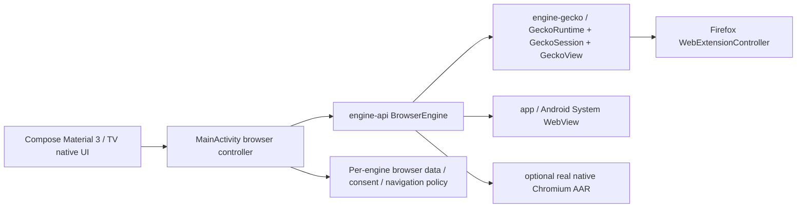

# Rudy Browser — GeckoView full rebuild master plan

Date: 2026-11-18  
Repository: private [RudyCity/tv-browser](https://github.com/RudyCity/tv-browser)  
Baseline at audit: `6d48497cb832a2d7f417e1abd58302124f926518` (`main`, 0.7.1).  
Supersedes neither history nor [2026-11-18 modernization master plan](2026-11-18-rudy-browser-modernization-master-plan.md); that document remains the evidence for earlier Compose/WebView milestones.

## Executive summary

Ship a genuinely GeckoView-backed Rudy Browser for compatible phones/tablets and TVs without removing the Android 4.4–7 legacy WebView application. Keep the existing `legacy` and `preview` flavors and add a separately installable `gecko` flavor with a real `GeckoRuntime`, `GeckoSession`, `GeckoView` and explicit WebView fallback. Build real Firefox WebExtensions support through Mozilla's API; never disguise WebView scriptlets or Chrome CRX files as Firefox extensions. Legacy and native Chromium source remain untouched. No Play Store publishing or production signing until authorized.

## P0 — audit and feature inventory (2026-11-18)

| Area | Verified at baseline | Gap / disposition |
| --- | --- | --- |
| Android builds | AGP 8.6.1; Gradle 8.7 in CI; `app`, `engine-api`, `compose-ui` | Gecko module absent; no Gecko binary packaged |
| Flavors | `legacy` min API 19, `preview` API 21, `chromium` API 29 only with genuine AAR | Add Gecko min API 26 separately, avoid affecting old APKs |
| Browser renderer | `WebViewEngine` implements `BrowserEngine`; `EngineFactory` reflection-locates optional Chromium | Extend factory for Gecko; actual engine state and lifecycle |
| User interface | Compose Material 3 toolbar/home for touch Preview; TV remote native Java | Complete tab UX, permissions, downloads, extensions, TV accessibility |
| Security | HTTP blocked on modern variants; popup and download approval; WebView TLS fails closed | Gecko permissions/navigation/window/download parity, per-engine data isolation |
| Extensions | WebView opt-in scripts; `docs/EXTENSIONS.md` accurately states no real browser extension API | Mozilla WebExtensions controller, XPI install/approval, management |
| Tabs | Single owned renderer, not real multi-tab | Independent engine session instances and persistence |
| Native Chromium | `native-chromium/` source-build experiment, no shipped AAR | Retain unchanged; NOT a fallback falsely reported as functioning |
| CI | `android-apk.yml`, `android-emulator.yml`, `chromium-native.yml` | Add isolated Gecko build/API29 emulator gate and extension tests |
| Evidence | Latest baseline APK Actions run [44234635578](https://github.com/RudyCity/tv-browser/actions/runs/44234635578) successful on baseline SHA | New Gecko-specific build and actual HTTPS render proof pending |

### Component diagram

## Target architecture and migration strategy

Retain `app` as the security-controller shell until controlled refactoring proves safe. `engine-api` owns engine contracts. Introduce `engine-gecko` with official Mozilla dependency (pinned) and a provider discovered by the existing factory without loading Gecko classes on legacy. `compose-ui` continues as a presentation module. Extract `browser-core`, `browser-data`, `browser-security`, `tv-ui`, and `extensions` only after tests justify separating source ownership. Do not make empty modules to manufacture apparent progress.

Per-flavor entry behavior: legacy API19+ -> WebView; preview API21+ -> WebView; gecko API26+ -> GeckoView by default when available, or explicitly requested WebView. Chromium variant remains disabled unless actual vetted AAR exists. No implicit cookie/session migration between Gecko and Android WebView. Engine changes destroy the previous owned view, retain only an eligible URL, and display a user-facing engine name and reason.

## Dependency / compatibility matrix

| Component | Planned floor | Evidence / restriction |
| --- | --- | --- |
| Android legacy | API 19 | Existing Java/System WebView flavor unchanged |
| Android Compose Preview | API 21 | Existing WebView/Compose flavor unchanged |
| Mozilla GeckoView | API 26 planned | Mozilla current Android product requirement; verify AAR manifest in CI, revise if actual minimum differs |
| GeckoView Maven | `org.mozilla.geckoview:geckoview:159.0.20261102144711` | Stable version listed Nov 3, 2026; resolve official Mozilla Maven URL in CI |
| Android TV | Old devices via WebView, compatible via Gecko | D-pad/IME/video/focus physical proof required |
| WebExtensions | Gecko only | Official `GeckoRuntime.getWebExtensionController()`; built-ins through `installBuiltIn`; other XPI installation only with supported API and consent |
| Chromium native | None certified | No fake CRX/Chrome Web Store support |
| Compiler and build | JDK 17, current AGP | Current CI uses Temurin 17 and AGP 8.6.1; Gecko Java 17 guide checked |

Official references (read 2026-11-18): [Mozilla Quick Start](https://firefox-source-docs.mozilla.org/mobile/android/geckoview/consumer/geckoview-quick-start.html), [Mozilla GeckoView guide](https://firefox-source-docs.mozilla.org/mobile/android/geckoview/index.html), [GeckoView WebExtensions](https://mozilla.github.io/geckoview/consumer/docs/web-extensions), [WebExtensionController API](https://mozilla.github.io/geckoview/javadoc/mozilla-central/org/mozilla/geckoview/WebExtensionController.html), [Maven version catalog](https://mvnrepository.com/artifact/org.mozilla.geckoview/geckoview/versions). Current nightly API docs may differ from the pinned stable artifact; compilation is authoritative.

## Threat model and controls

Attacker-controlled websites can trigger navigation, popup windows, downloads, scheme intents, deceptive installer APKs, permission prompts, mixed content, and renderer failures. Extension packages can request privileged permissions or intercept pages. Browser logs can leak URLs or authentication data. Controls: accept only qualified HTTP(S) top-level URLs, block cleartext on modern flavors, fail TLS certificate errors closed, never silently approve popup/new-tab/download/extension permissions, never grant camera/microphone/location/storage without user action, do not auto-open APKs, keep the Gecko sandbox intact, redact sensitive URLs and identifiers in logs. Gecko and WebView cookies/history/cache are disjoint; clearing one must never claim to clear the other. Private mode requires separate ephemeral sessions and verified deletion. Never enable hidden engine fallbacks or fake permissions.

## Rudy design system

Follow Taste Design + Antislop. Preserve a compact one-row phone toolbar, responsive tablet controls, true TV remote focus visibility, accessible minimum 48dp touch targets, restrained Material 3 colors, typography and tokens already in `compose-ui`. Prioritize viewport over dashboard ornaments. Loading/empty/error states, focused/screen reader labels, light/dark themes, and modal opt-in approvals must be audited under font scaling, orientation changes and TV D-pad.

## Phase sequence and acceptance gates

| Phase | Dependencies | Acceptance requirement | Status at creation |
| --- | --- | --- | --- |
| P0 Audit/foundation | Baseline | Preserve existing builds, commit this plan, add tested engine capability policy | Tested (legacy/Preview CI), runtime checks ongoing |
| P1 GeckoView integration | P0 | Official pinned AAR, real Gecko surface/session, navigation/lifecycle, HTTPS foreground emulator evidence | Tested (build/unit only, SHA b2802639); Runtime Verified pending |
| P2 Multi-engine | P1 | Accurate selection/recovery, isolation, WebView fallback with explicit reason | Implemented (policy/factory; real fallback runtime pending) |
| P3 Firefox WebExtensions | P1, P2 | At least one compatible extension installed/listed/reloaded via real Gecko API, consent and controls | Implemented (SHA b2186847); automated tests pending |
| P4 Design System | P0 | Material 3 toolbar, tabs, settings, permissions on phones/tablets; accessibility checks | In Progress (prior Compose work only) |
| P5 Real tabs | P2 | Independent GeckoSessions/WebViews, creation/switch/close/restore/private/memory policy | Not Started |
| P6 Browser features | P2–P5 | Search, bookmarks, history, downloads/upload, PDF, fullscreen, permissions, privacy functional tests | Not Started |
| P7 Android TV | P2, P4 | D-pad, remote pointer, 10-foot UI, video, fallback, focus instrumentation/physical device | Not Started |
| P8 Security and privacy | All | Popup/permissions/XPI/installer isolation, URL policy, TLS, privacy regression | Not Started |
| P9 Performance/stability | P1–P8 | Measured cold start, memory, crash recovery, video, CPU/GPU, long-running session baseline | Not Started |
| P10 Testing/CI | Each phase | Exact-SHA APK+unit+emulator tests; actual activity foreground, content pixel checks | In Progress (Gecko build passed on b2802639, runtime pending) |
| P11 Release readiness | All | Licenses, target SDK, signing custody, upgrade tests, APK/AAB and owner publication approval | Not Started |

Status vocabulary: **Not Started → In Progress → Implemented → Tested → Runtime Verified → Released**. Status applies per feature slice, not as a blanket claim for an entire phase. Implemented means code committed. Tested means build and relevant automated tests pass at exact SHA. Runtime Verified requires an actual emulator/device rendering result. Released requires a published and verified deliverable.

## CI / test strategy

Keep existing `Android APK` workflow green for legacy/preview, including APK ID, manifest and signing assertions. New Gecko CI must test exact pinned Maven resolution, Gecko variant compilation, engine selection policy, API 29 foreground activity and actual HTTPS rendering, real navigation/back/reload, crash/fallback, new-window consent, extension presence, and screen capture after launch. Avoid false screenshots of launcher or blank web content. Record workflow URL, SHA, number of tests, screenshots, logcat, runtime API level and ABI. Never weaken a red test merely to turn CI green.

## Release strategy and blockers

No unattended production release. Debug APKs are not production-upgrade-safe due to signing. Signing keys only from managed secrets; owner approves distribution, privacy disclosures, SDK/API levels, source notices, Mozilla license/third-party notices and physical device TV checks. Legacy device distribution stays separate; a native Chromium AAR requires separately certified build evidence. Risks: Gecko AAR size/ABI and JNI, permission API drift, TV memory, video DRM, loss of data when switching engine, API26 minimum, CI emulator GPU / actual page rendering. Mitigate with per-flavor delivery, explicit fallback and strict runtime smoke tests.

## Evidence log / current status

- **2026-11-18 audit:** HEAD `6d48497cb832a2d7f417e1abd58302124f926518`; private repo writable. `Android APK` run [44234635578](https://github.com/RudyCity/tv-browser/actions/runs/44234635578) successful (pre-Gecko baseline). Existing `engine-api` and `compose-ui` preserved. New Gecko source/tests/emulator evidence not yet available at creation time.
- **Next evidence entries:** record each incremental commit SHA, changed paths, Actions URL, test counts, emulator/API architecture, actual GeckoView renderer proof, failures/blockers, and remaining gaps. Never equate a source commit with a runtime success.

### Evidence appendix: iterative GitHub CI (2026-11-18)

- **6e492153**: Gecko engine selection, minimum API and fallback policy tests committed. `Android APK` run [44237951415](https://github.com/RudyCity/tv-browser/actions/runs/44237951415) **success**; Compose emulator [44237951460](https://github.com/RudyCity/tv-browser/actions/runs/44237951460) **success**.
- **44d288d9**: First genuine GeckoView module with version-pinned Mozilla AAR, explicit API26 flavor; old APK [44238228470](https://github.com/RudyCity/tv-browser/actions/runs/44238228470) **success**. Gecko [44238228490](https://github.com/RudyCity/tv-browser/actions/runs/44238228490) **failed** AAR metadata because SDK37/AGP9.1 is required.
- **4d52f90d**, **72b57414**, **73403cda**: Separate modern build root and Android 17 SDK CI corrections. GitHub runner exposed API37 package as `platforms;android-37.0`; after SDK resolution, the modern build failed while applying the old Kotlin Android plugin to AGP9.
- **b2802639**: AGP9 built-in Kotlin fixed via separate modern Compose build script; [Gecko build and unit-test job, run 44239262264](https://github.com/RudyCity/tv-browser/actions/runs/44239262264) **success** including package ID, debug APK signature verification, artifact upload. The API29 runtime job was still running at last check. No Gecko UI runtime success has yet been asserted.
- **b2186847**: Firefox WebExtensions real API wired into the Gecko flavor with signed XPI source review, Mozilla permission prompts, enable/disable, uninstall, and an original bundled content-script extension. Status **Implemented only**, until exact-SHA test gate passes.
- **09990a5b**: Instrumentation checks tightened to require Gecko first contentful paint on HTTPS and real Mozilla WebExtension install/list. Status **Implemented only** pending CI. Physical Android/TV verification and all production release gates **Not Started**.

Build results are SHA-scoped; an earlier successful build does **not** certify new commits. Do not mark an entire phase Released until an actual distributable is published and verified after explicit owner authorization.
